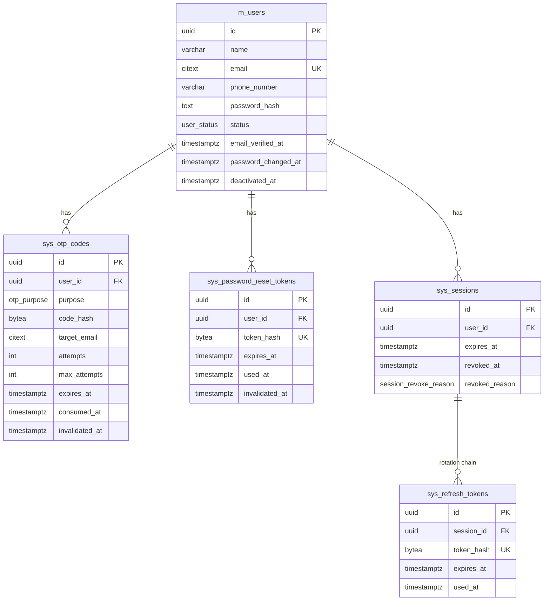

# Godigi — Authentication & User Management API

A REST API in Go and Gin covering registration with OTP verification, login,
JWT access tokens with rotating refresh tokens, password recovery, and profile
and account management. It runs as three services behind an API gateway, on
PostgreSQL and Redis, with request/response monitoring in Grafana.

```
                  ┌──────────────────────────────────────────────┐
 client ──HTTPS──▶│ api-gateway :8080                            │
                  │  request id · CORS · body limit · rate limits│
                  │  JWT verification (EdDSA public key only)    │
                  │  strips client X-User-ID/... headers         │
                  └───────┬───────────────────────────┬──────────┘
            /api/v1/auth/*│  X-Internal-Token         │/api/v1/users/*
                          │  X-User-ID, X-Session-ID  │
                  ┌───────▼────────┐          ┌───────▼────────┐
                  │ auth-service   │          │ core-service   │
                  │ :8091          │          │ :8092          │
                  │ register, OTP, │          │ profile, email │
                  │ login, tokens, │          │ change,        │
                  │ passwords      │          │ deactivation   │
                  └───┬────────┬───┘          └───────┬────────┘
                      │        │ Redis (rate limits)  │
                      ▼        ▼                      ▼
                  PostgreSQL ◀────────────────────────┘      Mail (Mailpit / file outbox)

 JSON logs (stdout / tmp/logs) ──▶ Alloy ──▶ Loki ──▶ Grafana :3030
```

| Directory | What it is |
|---|---|
| `api-gateway/` | The only public entry point. Verifies JWTs, applies rate limits and proxies requests to the services. Serves Swagger UI at `/docs`. |
| `auth-service/` | Register, verify/resend OTP, login, refresh, logout, forgot/reset/change password. Signs JWTs. |
| `core-service/` | `GET/PATCH /users/me`, email change with verification, deactivation. |
| `pkg/` | Shared module: OTP engine, session check, password/token crypto, JWT, rate limiter, mailer, HTTP envelope, access log and middleware. |
| `migrations/` | golang-migrate SQL migrations. |
| `monitoring/` | Loki, Alloy and Grafana config, including the provisioned dashboard. |
| `docs/` | OpenAPI spec, Postman collection and environment. |
| `scripts/` | `.env` generator, local runner, end-to-end scenarios. |

### Code layout

auth-service and core-service follow the same layering. Each layer only calls
the one below it:

```
<service>/
├── main.go                    wiring, graceful shutdown
└── internal/
    ├── config/                env → Config
    ├── router/                routes + middleware
    ├── handler/               HTTP: bind dto request → call service → write dto response
    ├── dto/                   API shapes
    │   ├── request.go         request bodies + validation tags
    │   └── response.go        response bodies + constructors from models
    ├── service/               business rules, transactions
    ├── repository/            SQL only (parameterised), returns models
    └── model/                 database entities (one struct per table row, no JSON tags)
```

| Service | `model/` | `dto/` | `repository/` |
|---|---|---|---|
| auth-service | `User`, `Session`, `RefreshToken`, `PasswordResetToken` | `RegisterRequest`, `VerifyOTPRequest`, `EmailRequest`, `LoginRequest`, `RefreshTokenRequest`, `ResetPasswordRequest`, `ChangePasswordRequest` → `UserResponse`, `TokenResponse` | users, sessions + refresh tokens, password reset tokens, cleanup |
| core-service | `User`, `ProfileUpdate` | `UpdateProfileRequest`, `ChangeEmailRequest`, `VerifyEmailChangeRequest`, `DeactivateRequest` → `ProfileResponse`, `EmailChangeResponse` | users, session revocation |

Models and DTOs are kept apart on purpose. `model.User` carries the password
hash and has no JSON tags, so it cannot be serialised by accident. A response
only ever contains the fields its `dto` constructor copies across.

Two components shared by both services own their own SQL in `pkg/`:
`pkg/otp` (the `sys_otp_codes` engine: issue, verify, attempts, cooldown) and
`pkg/authn` (the per-request session check). Each is one piece of logic used
identically by both services.

---

## 1. Running it

### Prerequisites
- Go 1.26+, PostgreSQL 14+, Redis 6+, `openssl`, Python 3 (only for the e2e script)
- or Docker with Compose v2

### Option A: local processes (no Docker)

```bash
make env                 # creates .env with freshly generated keys and secrets
# edit .env: set DATABASE_URL to your database
make migrate-up          # applies migrations/ with golang-migrate
make run                 # builds and starts the three services (logs in tmp/logs/)
make e2e                 # 85 end-to-end checks against the running gateway
make monitoring-up       # optional: Grafana at http://localhost:3030 (needs Docker)
make stop
```

With `MAIL_DRIVER=file` (the default in `.env.example`), outgoing mail is
written to `tmp/outbox/*.eml`. Read OTPs and reset tokens from there.

### Option B: Docker Compose

```bash
make env                 # set POSTGRES_PASSWORD in .env
docker compose up -d --build
```

Compose starts Postgres, Redis, **Mailpit** (inbox UI at http://localhost:8025),
runs the migrations once, then starts the services. Only the gateway (`:8080`)
and Mailpit are published. auth-service and core-service are reachable only
inside the compose network. Add `--profile monitoring` to also start Loki,
Alloy and Grafana.

Default ports: gateway 8080, auth-service 8091, core-service 8092, Grafana 3030,
Loki 3101 (localhost only), Mailpit 8025/1025, compose Postgres 5433, compose
Redis 6380. Every host port can be overridden in `.env` (`GATEWAY_HOST_PORT`,
`GRAFANA_HOST_PORT`, …).

### API docs
- Swagger UI: http://localhost:8080/docs (spec: [`docs/openapi.yaml`](docs/openapi.yaml))
- Postman: import [`docs/godigi.postman_collection.json`](docs/godigi.postman_collection.json)
  and [`docs/godigi.postman_environment.json`](docs/godigi.postman_environment.json),
  then run the folders in order. Each request stores tokens and codes for the
  next. The "Mailpit: …" requests read codes automatically when running on
  Docker. Locally, copy the code from `tmp/outbox` into the `otp` or
  `resetToken` variable.

### Tests
| Command | Covers |
|---|---|
| `make test` | Unit tests: argon2id hashing, password policy, OTP HMAC binding, JWT (rejects `alg=none`, HS256 algorithm confusion, foreign keys, wrong issuer/type, expiry), strict JSON binding, gateway header trust boundary, access-log redaction. |
| `make e2e` | 85 checks over the real stack, including concurrency (5 parallel OTP verifications and 5 parallel refreshes each succeed exactly once), reuse detection, every revocation path, rate limits, protected fields, and a final scan proving no emailed OTP/reset token, JWT or password reached the logs. Against Docker: `BASE_URL=http://localhost:8080 MAILPIT_URL=http://localhost:8025 REDIS_CLI="redis-cli -p 6380" make e2e`. |

---

## 2. Configuration

Everything comes from environment variables. See [`.env.example`](.env.example)
for the full annotated list. Secrets are required and validated at startup; a
service refuses to start and lists every missing or invalid value.

| Variable | Used by | Purpose |
|---|---|---|
| `DATABASE_URL` | auth, core | PostgreSQL DSN |
| `REDIS_URL` | gateway, auth | Rate-limit counters |
| `INTERNAL_SERVICE_TOKEN` | all | Shared secret the gateway presents to services (≥ 32 chars) |
| `JWT_PRIVATE_KEY` | auth | Ed25519 private key (base64 of PEM). Signs access tokens. |
| `JWT_PUBLIC_KEY` | gateway | Ed25519 public key. Verifies only. |
| `OTP_PEPPER` | auth, core | HMAC key for OTP hashes (base64, ≥ 32 bytes) |
| `ACCESS_TOKEN_TTL` / `REFRESH_TOKEN_TTL` / `SESSION_MAX_AGE` | auth | `15m` / `168h` / `720h` |
| `OTP_TTL` / `OTP_MAX_ATTEMPTS` / `OTP_RESEND_COOLDOWN` / `OTP_MAX_PER_HOUR` | auth, core | `5m` / `5` / `60s` / `5` |
| `PASSWORD_RESET_TTL` / `PASSWORD_RESET_COOLDOWN` | auth | `15m` / `60s` |
| `LOGIN_MAX_FAILURES` / `LOGIN_LOCKOUT` | auth | `5` failures → `15m` lockout per account |
| `RATE_LIMIT_*` | gateway | Per-IP and per-user request budgets |
| `TRUSTED_PROXIES` | gateway | CIDRs allowed to set `X-Forwarded-For` (empty = trust none) |
| `MAIL_DRIVER` | auth, core | `smtp` (Mailpit) or `file` (`MAIL_OUTBOX_DIR`) |
| `LOG_HTTP_BODIES` | gateway | Log redacted request/response bodies (default `false`; `true` in `.env.example`) |
| `GRAFANA_ADMIN_PASSWORD` | compose | Grafana `admin` password (generated by `make env`) |
| `GRAFANA_HOST_PORT` / `LOKI_HOST_PORT` | compose | `3030` / `3101` |

`make env` (`scripts/init-env.sh`) generates the key pair with
`openssl genpkey -algorithm ed25519`, plus random values for the internal
token, the pepper and the Grafana admin password. `.env` is git-ignored and created with mode `0600`.

---

## 3. API

All routes are under `http://localhost:8080`. Protected routes need
`Authorization: Bearer <access_token>`.

| Method | Path | Auth | Description |
|---|---|---|---|
| POST | `/api/v1/auth/register` | – | Register (unverified) and email an OTP |
| POST | `/api/v1/auth/verify-otp` | – | Verify the registration OTP |
| POST | `/api/v1/auth/resend-otp` | – | Resend the OTP (60s cooldown, 5/hour) |
| POST | `/api/v1/auth/login` | – | Email + password → token pair |
| POST | `/api/v1/auth/refresh` | – | Rotate the refresh token, get a new access token |
| POST | `/api/v1/auth/logout` | – | Revoke the session behind a refresh token |
| POST | `/api/v1/auth/forgot-password` | – | Email a reset token (always the same generic 200) |
| POST | `/api/v1/auth/reset-password` | – | Reset with token; revokes all sessions |
| POST | `/api/v1/auth/change-password` | Bearer | Requires current password; revokes other sessions |
| GET | `/api/v1/users/me` | Bearer | Own profile |
| PATCH | `/api/v1/users/me` | Bearer | Update `name`, `phone_number` only |
| POST | `/api/v1/users/me/change-email` | Bearer | Requires current password; sends OTP to new address |
| POST | `/api/v1/users/me/change-email/verify` | Bearer | Apply the change with the OTP |
| POST | `/api/v1/users/me/deactivate` | Bearer | Requires current password; revokes everything |

**Envelope.** Success responses look like
`{"success":true,"message":"…","data":{…},"request_id":"…"}`. Errors look like
`{"success":false,"error":{"code":"…","message":"…","details":[{"field":"…","message":"…"}]},"request_id":"…"}`.
`error.code` is stable and meant for clients to branch on, for example
`VALIDATION_ERROR`, `INVALID_CREDENTIALS`, `EMAIL_NOT_VERIFIED`,
`TOKEN_EXPIRED`, `SESSION_REVOKED`, `REFRESH_TOKEN_REUSED`, `INVALID_OTP`,
`OTP_ATTEMPTS_EXCEEDED`, `OTP_RESEND_COOLDOWN` or `RATE_LIMITED`. `429`
responses carry `Retry-After`. Every response carries `X-Request-ID`, which
also appears in every log line for that request.

**Token pair.**
```json
{ "access_token": "eyJ…", "token_type": "Bearer", "expires_in": 900,
  "refresh_token": "kq3…", "refresh_expires_in": 604800 }
```

---

## 4. Flows

**Registration.** `register` creates the user as `pending_verification` and
issues an OTP in the same transaction. The mail is queued after commit.
`verify-otp` consumes the code and flips the user to `active` atomically.
`resend-otp` invalidates the previous code before issuing a new one.

**Login.** The per-account failure counter is checked first. Then the password
is verified; unknown emails still run a dummy argon2 verification, so timing
reveals nothing. Then the status is checked. Only then is a `sessions` row
created in `sys_sessions`, together with the first refresh token. The access token carries the
session id in `sid`.

**Refresh (rotation with reuse detection).** The presented token is looked up
by SHA-256 hash and its row and session are locked (`FOR UPDATE`). A token that
was never used is marked used and a successor is issued in the same session. A
token that was already used means two parties hold it, so the whole session is
revoked. That revocation is committed even though the request fails.

**Password reset.** `forgot-password` responds immediately with the same
message for any input; the lookup and email happen in the background, so
response timing does not reveal account existence either. `reset-password`
consumes the single-use token, sets the password, and revokes every session,
reset token and OTP. Completing a reset proves mailbox ownership, so it also
verifies a still-pending account. This means a real owner can reclaim an
address someone else registered without verifying it.

**Email change.** `change-email` requires the current password and sends an OTP
to the new address. Nothing changes until `change-email/verify`. The old
address then gets a notification.

**Deactivation.** Requires the current password. In one transaction it sets
the status to `deactivated`, revokes all sessions, and invalidates OTPs and
reset tokens.

### How existing tokens behave after deactivation (and logout, reset, change)

Revocation is **immediate**, not "when the token expires":

| Token | After deactivation |
|---|---|
| Access token (JWT) | The signature is still valid until `exp`, but every protected endpoint re-checks its `sid` against `sys_sessions`, joined with the user's status, on **every request** (`pkg/authn`). The session is revoked, so the next call returns `401 SESSION_REVOKED`. |
| Refresh token | Its session is revoked, so `401 INVALID_REFRESH_TOKEN`. Refresh also re-checks the user's status independently. |
| New login | `403 ACCOUNT_DEACTIVATED`, returned only after a correct password. |
| Password reset | `forgot-password` silently does nothing for deactivated accounts. `reset-password` refuses their tokens. |

The same mechanism handles the other revocation paths. Logout revokes one
session. A password reset revokes all of them. A password change revokes all
except the caller's. Refresh-token reuse revokes the affected session.
Reactivation is out of scope; see Limitations.

---

## 5. Database design

### Naming convention

| Prefix | Meaning | Tables |
|---|---|---|
| `m_` | Master data: the account itself | `m_users` |
| `sys_` | System/security records created and consumed by the auth flows | `sys_sessions`, `sys_refresh_tokens`, `sys_otp_codes`, `sys_password_reset_tokens` |

Constraints and indexes carry their table's name (`m_users_email_key`,
`sys_otp_codes_one_active_per_purpose`, …), so a constraint violation or a
`\d` listing says which table it belongs to.

The whole schema, with these names, is created by a single migration:
[`migrations/000001_init_schema.up.sql`](migrations/000001_init_schema.up.sql).



Design decisions:

- **`citext` email with a UNIQUE constraint.** This settles duplicate
  registrations and email-change races, including concurrent ones that pass
  any "does it exist?" pre-check. `Jane@x.com` and `jane@x.com` cannot both
  exist.
- **Postgres enums and CHECK constraints encode the state machine.** A
  non-pending user must have `email_verified_at`. `deactivated` ⇔
  `deactivated_at` is set. An OTP can't be both consumed and invalidated. Only
  `email_change` OTPs carry a `target_email`. A revoked session must have a
  reason. Bugs in application code can't write an impossible state.
- **Partial unique indexes enforce "only one live item".** For example,
  `sys_otp_codes (user_id, purpose) WHERE consumed_at IS NULL AND invalidated_at IS NULL`,
  one active reset token per user, and one *unused* refresh token per session,
  which keeps the rotation chain linear.
- **Only hashes are stored.** Refresh and reset tokens are 256-bit random
  values stored as SHA-256. That is enough because they are unguessable, and
  it allows an indexed lookup. OTPs have only 10⁶ values, so a plain hash
  could be reversed by brute force. They are stored as an **HMAC keyed with
  `OTP_PEPPER`**, which lives outside the database, and bound to the user id
  and purpose.
- **History rather than deletion.** Codes and tokens are retired by setting
  `consumed_at`, `used_at` or `invalidated_at`, which keeps an audit trail and
  feeds the hourly OTP cap. An hourly janitor in auth-service purges rows that
  no longer affect any decision.
- **Indexes match the queries.** `(user_id, purpose, created_at DESC)` serves
  cooldown checks, and partial `sys_sessions(user_id) WHERE revoked_at IS NULL`
  serves "revoke all". Hash lookups go through the unique constraints.
- **Access library: `pgx` with hand-written SQL, no ORM.** This system's
  correctness depends on explicit transactions, `SELECT … FOR UPDATE` /
  `FOR SHARE`, partial indexes and constraint names. Plain SQL keeps all of
  that visible and reviewable in each service's `internal/repository`. Every query is parameterised, so
  no SQL is built from strings, which rules out SQL injection.
- **Migrations: golang-migrate** with paired up/down files. `000001_init_schema`
  creates the complete current schema. Its output was verified identical
  (`pg_dump --schema-only`) to the running database, and up → down → up was
  tested on a scratch database. Run it with `make migrate-up` (local, uses
  `DATABASE_URL` from `.env`) or let the `migrate` container do it
  (`docker compose up`). From here on, schema changes go in new numbered
  files (`000002_…`) rather than edits to `000001`, because a database that
  has already applied a file never re-reads it.

### Concurrency

| Race | What settles it |
|---|---|
| Two registrations with the same email | `m_users_email_key` unique constraint → second gets `409` |
| Parallel OTP verifications with the right code | Row lock on the OTP: one consumes it, the rest see no live code (e2e: 5 parallel → exactly 1 success) |
| Parallel wrong OTP guesses | Row lock serialises them; every attempt is counted, and **committed even though the request fails** (`database.CommitAndFail`), otherwise a rollback would hand out free guesses |
| Parallel resends | User row lock (`FOR UPDATE`) serialises the cooldown/cap check; the partial unique index is the backstop |
| Parallel refreshes with the same token | Row lock: one rotates, the others are detected as reuse (e2e: 5 parallel → exactly 1 success) |
| Login racing deactivation | Login creates the session under `FOR SHARE` on the user row, which conflicts with deactivation's `FOR UPDATE` |
| Reset token used twice concurrently | Token row lock plus re-check inside the transaction |

**Deadlock avoidance.** Every flow locks in the same order: `m_users` →
`sys_otp_codes` / `sys_password_reset_tokens` → `sys_sessions`. The reset flow first reads
the token without a lock to find the user, locks the user, and then locks the
token, precisely so that it keeps this order.

---

## 6. Security controls

| Requirement | Implementation |
|---|---|
| Password hashing | **argon2id**, OWASP parameters (m=19 MiB, t=2, p=1), PHC string format so parameters can be raised later. Policy: 8–128 chars, at least one letter and one digit, no leading/trailing space or control characters, not a common password, not equal to the email. |
| OTP expiry, single use, attempts | 5-minute TTL, consumed on success, 5 attempts then retired, 60s resend cooldown, 5 per hour, previous code invalidated on reissue. |
| JWT validation | Ed25519 (`EdDSA`). The algorithm is **pinned**, so `alg=none` and HS256-with-public-key tokens are rejected (both have unit tests). Issuer, audience, `exp`, `iat` and the token `typ` are required, and the subject and `sid` must be UUIDs. The gateway holds only the public key, so it cannot mint tokens. |
| Refresh token storage, rotation, revocation | Opaque 256-bit tokens stored hashed. Single-use with rotation. Reuse revokes the session. Sliding 7-day expiry capped by a 30-day absolute session lifetime. |
| Request validation, consistent errors | Strict JSON binding: unknown fields, trailing data, wrong types and oversize bodies are rejected (1 MiB limit). Per-field validation messages. One error envelope everywhere. A 500 never exposes its cause. |
| SQL injection | Parameterised queries only (`internal/repository`, `pkg/otp`, `pkg/authn`). |
| Rate limiting | Redis fixed-window counters at the gateway: global per IP (fails *open*), per IP per credential endpoint (fails *closed*), per user for password-checking endpoints. auth-service adds a per-account login lockout that also counts unknown emails, so a lockout doesn't reveal account existence. |
| No unauthorised profile changes | `PATCH /users/me` accepts only `name` and `phone_number`. Any other field returns a 400 naming it. Email, password and status each have their own verified flow. |
| Trust boundary between services | The gateway deletes any client-sent `X-User-ID`, `X-Session-ID`, `X-Internal-Token` or `X-Client-IP` before setting its own. Services reject calls without the internal token, compared in constant time. The gateway does not forward `Authorization`. |
| Enumeration resistance | Generic `INVALID_CREDENTIALS`. Dummy hash for unknown emails. Identical responses for forgot-password and resend-otp. Background processing of forgot-password. |
| No secrets in logs or responses | Codes and tokens leave the system only by email. Access logs never include the query string or headers. Request/response bodies (gateway, `LOG_HTTP_BODIES`) are logged only as parsed JSON, with `password`, `current_password`, `new_password`, `otp`, `token`, `access_token` and `refresh_token` replaced by `[REDACTED]` at any depth and emails masked. Non-JSON, unparseable or oversized bodies are replaced by a placeholder rather than logged raw. Mail logs record a masked recipient and the subject, never the body. `make e2e` ends by scanning the logs for every emailed code and token, any JWT, and this run's passwords, and fails on any hit. |
| Secrets in env | All keys, peppers and passwords come from the environment, validated at startup. `.env` is git-ignored, and `.env.example` holds no real values. |
| Transport and headers | `Cache-Control: no-store`, `nosniff`, `X-Frame-Options: DENY`, `Referrer-Policy: no-referrer`, CORS allow-list, server read/write/idle timeouts. Containers are distroless and run as non-root. |

---

## 7. Monitoring (Grafana)

```
api-gateway ─┐                                    ┌─ Grafana :3030
auth-service ├─ JSON logs ─▶ Alloy ─▶ Loki :3101 ─┤   dashboard "Godigi - HTTP requests & responses"
core-service ┘  (container stdout or tmp/logs)    └─ Explore (ad-hoc LogQL)
```

```bash
make monitoring-up      # Loki + Alloy + Grafana, for the `make run` setup
# or: docker compose --profile monitoring up -d   (app stack + monitoring)
```

Open http://localhost:3030 and log in as `admin` with
`GRAFANA_ADMIN_PASSWORD` from `.env`. The dashboard is provisioned and set as
the home page.

**What is logged.** Every service writes one JSON line per request
(`"msg":"http_request"`):

```json
{"time":"…","level":"INFO","msg":"http_request","service":"api-gateway",
 "request_id":"197544cc-…","method":"POST","path":"/api/v1/auth/login",
 "route":"/api/v1/auth/login","status":200,"latency_ms":24.6,"bytes_in":82,
 "bytes_out":712,"client_ip":"::1","user_agent":"…",
 "request_body":{"email":"a***@example.com","password":"[REDACTED]"},
 "response_body":{"success":true,"data":{"access_token":"[REDACTED]",
   "refresh_token":"[REDACTED]","token_type":"Bearer","expires_in":900}}}
```

`user_id` is added for authenticated requests, and `error_code` (from the
envelope) for 4xx/5xx. Bodies are logged by the gateway only (it sees every
request and response once), and only when `LOG_HTTP_BODIES=true`. Levels:
2xx/3xx `INFO`, 4xx `WARN`, 5xx `ERROR`.

**Collection.** Alloy (`monitoring/alloy/config.alloy`) reads two sources:
containers labelled `godigi.logs=true` through the Docker socket
(`source="docker"`), and `tmp/logs/*.log` from `make run`
(`source="local"`). It keeps only `service`, `level` and `source` as Loki
labels, since they are low-cardinality. Status, route, latency and the rest
are parsed at query time with `| json`. Loki keeps 7 days.

**Dashboard panels** (filters: Service, Source, free-text log search):

| Panel | Shows |
|---|---|
| Requests / Error rate / Server errors / Latency p95 | Totals for the selected range |
| Requests by status class | 2xx / 4xx / 5xx over time |
| Latency p50 / p95 / p99 | From `latency_ms` |
| Top routes | Request count per method + route; `(unmatched)` = 404s |
| Error codes | Count per `error_code`, e.g. `INVALID_CREDENTIALS`, `RATE_LIMITED`, `SESSION_REVOKED` |
| Requests by service | Gateway vs auth vs core traffic |
| Request / response log | Every request line with its redacted bodies; expand for fields |
| Warnings & errors | All `WARN`/`ERROR` lines from every service |

The Service filter defaults to `api-gateway`, which sees each request once.
Selecting more services counts a request again at each hop. Clicking a
`request_id` in a log line shows every line (gateway and service) for that
request.

Example queries for Explore:

```logql
{service="api-gateway"} |= "http_request" | json | status >= 500
{service="api-gateway"} |= "http_request" | json | error_code="INVALID_CREDENTIALS"
{service=~".+"} |= "<request_id>"
```

---

## 8. Trade-offs

- **The session check costs one DB query per authenticated request.** Purely
  stateless JWTs would make revocation wait for `exp`, up to 15 minutes. The
  per-request check is a primary-key lookup joined to `users`, and it makes
  logout, reset and deactivation take effect immediately. The gateway stays
  stateless with respect to the database; the services do the check.
- **One shared database for auth-service and core-service.** The split is by
  API responsibility, with shared SQL in `pkg/store`. Deactivation revokes
  sessions in the same transaction as the status change, which would need a
  distributed protocol if the services owned separate databases. The internal
  token boundary means the services could later be split at the data layer
  behind internal APIs.
- **OTPs live in Postgres, not Redis.** Verifying a code must change other rows
  atomically (activate the account, change the email). Redis is used only for
  rate-limit counters, where losing data is harmless.
- **Strict refresh-token reuse detection.** A client that retries a refresh
  after a network error, with the old token, is logged out. Some systems allow
  a short grace window; this one prefers the safer behaviour.
- **`register` returns 409 for an existing email**, as the brief requires.
  That reveals that the address is registered, so registration is
  rate-limited. Every other endpoint is enumeration-resistant.
- **Fixed-window rate limiting** can admit up to twice the limit across a
  window boundary. It is accepted because the hard limits on guessing (OTP
  attempts, account lockout) are enforced elsewhere.
- **Body logging is on in development.** Seeing the request and response in
  Grafana is valuable for debugging and for this demo. Redaction is by key
  name, so a new secret field must be added to `sensitiveKeys` in
  `pkg/httpx/accesslog.go`. For production, `LOG_HTTP_BODIES=false` is the
  safer default and leaves all metrics and the request log intact without
  bodies.
- **Redis failure modes.** The global limiter fails open, so a Redis outage
  doesn't take the API down. Credential endpoints and the login lockout fail
  closed (`503`), so a Redis outage doesn't remove brute-force protection.

## 9. Limitations / next steps

- No account reactivation or admin API. A deactivated account keeps its email,
  so the address cannot be re-registered.
- Unverified accounts are never purged; a cleanup job would free squatted
  addresses. A password reset already lets the real owner reclaim one.
- Email is a mock (Mailpit/file). Production would need a real provider and an
  outbox table, so mail survives a crash between commit and send.
- The access-token signing key has no rotation (`kid`, JWKS). Today, rotating
  it means redeploying the gateway with the new public key.
- TLS is expected to be terminated in front of the gateway. Set
  `TRUSTED_PROXIES` to that proxy's CIDR so client IPs are correct.
- Monitoring is log-based: dashboard metrics are computed from log lines at
  query time. At higher traffic, Prometheus metrics (or Loki recording rules)
  and tracing would be cheaper and more precise. Grafana has no alerting
  configured.
